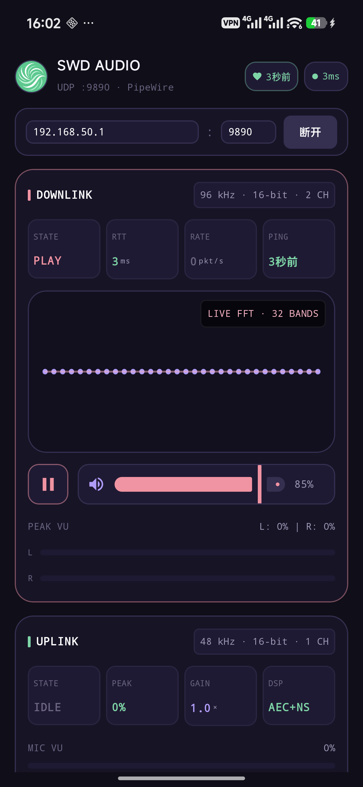
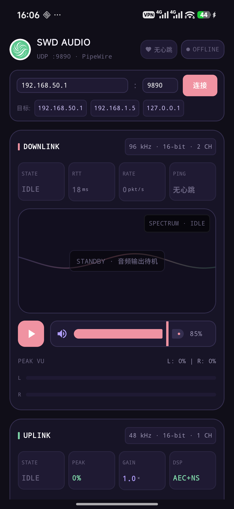
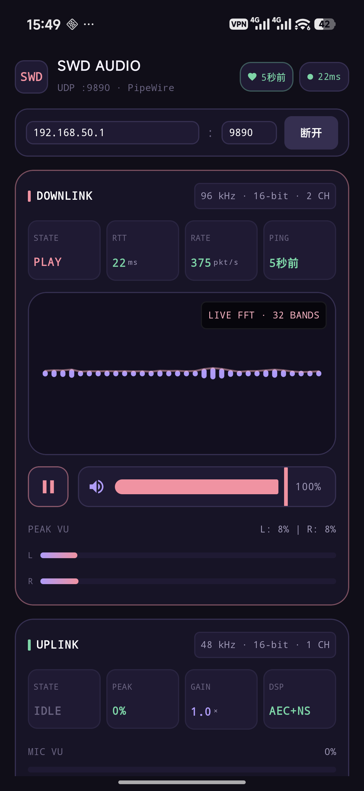

<p align="center">
  
</p>

<h1 align="center">Swdw (SWD)</h1>

<p align="center">
  <strong>PipeWire 极低延时音频监听 · 移动端虚拟麦克风 · 樱花夜色</strong><br/>
  基于 Rust 原生守护进程与 Compose Multiplatform 构建的局域网高保真双向 UDP 音频流系统。
</p>

<p align="center">
  <a href="README.md">English</a> · <strong>简体中文</strong>
</p>

<p align="center">
  Linux PipeWire · 原生 Rust 守护进程 · 桌面 JVM · Android 原生持久前台服务 · 96kHz 双声道立体声 · 极简数据状态仪表盘
</p>

---

## Swdw 是什么

**Swdw**（原名 SWD）是一套面向 Linux 桌面与多平台移动端的高保真、超低延迟音频直连系统，专注解决两项核心诉求：
1. **系统回放实时监听（Downlink）**：将 Linux 宿主机正在播放的所有系统音频以母带级采样率（96kHz 16-bit 双声道）实时串流至 Android 手机或桌面客户端耳机，端到端延迟控制在硬件感官极限（~10-18ms）。
2. **反向虚拟麦克风（Uplink）**：将手机麦克风采集的语音以低延迟反向推流至 Linux 宿主机，通过 PipeWire 虚拟输入节点（`SWD-Virtual-Mic`）直接注入为系统全局麦克风，供 Discord、腾讯会议、OBS 等任意软件透明调用。

### 为什么需要 Swdw

在 Linux 桌面生态中，将电脑声音传输到手机监听或利用手机充当电脑麦克风是一个长期存在痛点的场景：
- **传统流媒体方案（HTTP / RTSP / VLC / PulseAudio TCP Tunnel）**：建立在 TCP 协议之上，当无线局域网出现哪怕几个毫秒的抖动，TCP 的拥塞控制和累积重传机制会导致音频播放瞬间出现明显的“爆音、加速重放或缓冲区膨胀”，端到端延迟往往累积到几百毫秒甚至数秒，根本无法用于看视频、打游戏或监听混音。
- **第三方专有闭源工具（AudioRelay / SNDCP）**：功能受限、依赖专有协议、无法深度定制，且往往缺乏对现代化 Linux 音频中枢 **PipeWire** 的低量子原生支持。
- **Web 端 PWA / 浏览器伪后台**：依赖移动端浏览器的“静音音频占坑循环”，手机一旦熄屏或切换至后台，几分钟内必被移动操作系统内存管理机制冻结杀后台。

Swdw 采用**端到端全链路去缓冲**与**本地优先**设计理念：
- **宿主机内核级原生采集**：Rust 后端基于 `cpal` + `PipeWire`，直接捕获默认混音 Sink 的监控流，硬件量子（Quantum）锁死在 `256/96000`，单周期硬件采集延迟仅 **2.67ms**。
- **无状态纯 UDP 数据报直连**：单包 MTU 安全切片，序列号乱序保护。音频传输采用纯无连接广播模式，网络抖动时允许极微小丢帧（人耳几乎不可闻），绝不引起重传缓冲膨胀，始终保证绝对的“实时性”。
- **按需推流与心跳解耦**：音频流订阅与探活心跳完全解耦。Client 每 8 秒发送简短 PING 保活，Server 回复 ECHO，4 秒无应答自动判定离线并触发 UI 告警；只有当客户端主动启动播放时才建立推流通道，待机时零带宽占用。
- **系统级持久前台服务（Android）**：Android 客户端基于原生 Foreground Service (`mediaPlayback|microphone`)，配合 `WakeLock` 与 `MediaSessionCompat`，拥有完整的锁屏交互通知卡片，锁屏熄屏永不断流。

<p align="center">
  
</p>

---

## 功能一览

- **母带级 96kHz / 16-bit 双声道下行监听**：直接监听 PipeWire 默认输出混音，全采样率保留，细节丝丝入扣。
- **反向虚拟麦克风节点（Virtual Mic）**：宿主机注册原生 `Audio/Source` 节点（48kHz），客户端输入自动注入，硬件级回声消除（AEC）与智能降噪（NS）一键切换。
- **极简数据状态仪表盘（Data-First UI）**：
  - 抛弃一切冗余口号，全界面以技术参数为核心：`STATE`（当前状态）、`RTT`（往返延迟）、`RATE`（实时包率 pkt/s）、`PING`（心跳距今时长）、`PEAK`（峰值幅度）、`GAIN`（数字增益调节 0.1x ~ 3.0x）、`DSP`（信号处理状态）。
  - 双声道独立 Peak VU 电平表，动态范围实时反馈。
  - 实时 Canvas 32 频段 FFT 频谱跳动柱图与待机平滑波形。
  - 全界面采用 AndroidX Material 扩展图标，单行紧凑布局防折行。
- **交互式原生通知卡片（MediaSession Foreground Service）**：
  - 深度适配 Android 锁屏与通知中心，深色底板配合宿主发行版 Logo（如 Arch Linux）与品牌徽标。
  - 支持锁屏直接操作：播放/暂停、麦克风快速开/关、一键断开。
  - 实时显示心跳时间戳与推流延时。
- **systemd 用户服务一键开机自启**：附带一键部署脚本，开机无感静默运行，占用宿主机极低 CPU（< 1%）。
- **Compose Multiplatform 多端架构**：业务引擎与 UI 组件集中在 `shared` 模块，桌面端（Linux/macOS/Windows JVM）与 Android 原生应用高度统一。

---

## 界面展示

| 主状态面板（待机） | 实时监听推流（播放中） | 系统锁屏通知卡片 |
|:---:|:---:|:---:|
|  |  |  |

---

## 通讯协议规范 (Direct UDP Protocol)

所有 UDP 数据包起始均包含 4 字节固定魔数 `SWD\x01`（`0x53, 0x57, 0x44, 0x01`），无复杂握手，开箱即通：

| 操作码 (Opcode) | 报文名称 | 方向 | 报文字段格式说明 |
|:---:|:---:|:---:|:---|
| `0x01` | 音频下行数据包 | 宿主 → 客户端 | `[4B Magic][1B 0x01][4B Seq][4B SampleRate][1B Channels][1B Bits][2B PayloadLen][PCM 16-bit LE Data]` |
| `0x02` | 麦克风上行数据包 | 客户端 → 宿主 | `[4B Magic][1B 0x02][4B Seq][4B SampleRate][1B Channels][1B Flags][2B PayloadLen][PCM 16-bit LE Data]` |
| `0x03` | 客户端订阅保活包 | 客户端 → 宿主 | `[4B Magic][1B 0x03][4B ClientId]`（告知服务端本客户端需要接收音频流） |
| `0x04` | 取消推流注销包 | 客户端 → 宿主 | `[4B Magic][1B 0x04]`（客户端暂停播放或断开时通知注销订阅） |
| `0x06` | PING 探测心跳包 | 客户端 → 宿主 | `[4B Magic][1B 0x06][8B ClientTimestamp]`（每 8 秒轮询网络与存活状态） |
| `0x86` | ECHO 心跳应答包 | 宿主 → 客户端 | `[4B Magic][1B 0x86][8B EchoTimestamp][4B SampleRate][1B Channels]` |
| `0x05` | 局域网服务发现包 | 客户端 → 广播 | `[4B Magic][1B 0x05]` |
| `0x85` | 服务发现响应包 | 宿主 → 客户端 | `[4B Magic][1B 0x85][JSON 宿主状态与硬件负载]` |

### 延时剖析 (Latency Breakdown)

| 阶段 | 典型延迟 | 说明 |
|:---|:---:|:---|
| PipeWire Quantum 捕获 | ~2.67 ms | 量子配置 `256/96000`，单周期硬件 PCM 填充耗时 |
| 宿主 UDP 打包发送 | < 0.2 ms | 无锁环形缓冲与内存复用 |
| 局域网 Wi-Fi 5G 传输 | ~2.0 - 5.0 ms | UDP 直连避免任何 TCP 握手与重传排队 |
| 移动端 AudioTrack 回放缓冲 | ~8.0 - 12.0 ms | 低延迟 AudioTrack 模式，最小化 Jitter Buffer |
| **端到端总延迟 (Total E2E)** | **~13 - 19 ms** | 达到人耳无法分辨音画不同步的极速体验 |

---

## 快速上手与运行

### 1. 部署 Rust 录制服务端 (Linux 宿主)

依赖环境：`pipewire`, `pipewire-pulse`, `clang`, `rustc` / `cargo`。

```bash
# 1. 赋予执行权限并一键安装为 systemd 用户服务
chmod +x install_service.sh backend/start.sh
./install_service.sh

# 检查服务运行状态
systemctl --user status swdwd.service
```

如果需要手动前台调试运行：
```bash
cd backend
cargo run --release
```
服务端将在 `0.0.0.0:9890` 启动 UDP 监听与 HTTP `/api/status` 遥测接口。

### 2. 编译并运行桌面客户端 (JVM)

```bash
./gradlew :desktopApp:run
```

### 3. 安装 Android 客户端

项目配置了完整的 Gradle 构建脚本：

```bash
# 连接手机并开启 USB 调试或无线调试
adb devices

# 直接编译 Release 并安装至设备
./gradlew :androidApp:installRelease

# 启动应用
adb shell am start -n com.acite.swdw/.MainActivity
```

或者仅编译 APK 安装包：
```bash
./gradlew :androidApp:assembleRelease
# 安装包生成于：androidApp/build/outputs/apk/release/androidApp-release.apk
```

---

## 代码结构

本项目基于标准的 Kotlin Multiplatform 工程结构与 Cargo 工作区组织：

```
Swdw/
├── backend/                  # 原生 Rust 录制守护进程
│   ├── src/
│   │   └── main.rs           # PipeWire 捕获、虚拟麦克风、无锁环形缓冲、UDP 广播引擎
│   ├── Cargo.toml            # cpal, tiny_http, sysinfo, socket2 等依赖
│   └── start.sh              # 启动脚本
├── shared/                   # Compose Multiplatform 共享核心模块
│   └── src/
│       ├── commonMain/       # 跨平台通用逻辑
│       │   ├── kotlin/com/acite/swdw/
│       │   │   ├── client/   # SwdClientEngine 状态机、包率统计、心跳轮询
│       │   │   ├── model/    # ConnectionState、AudioPacket 等数据模型
│       │   │   ├── theme/    # KataHana 樱花夜色配色与排版
│       │   │   └── ui/       # SwdMainScreen、实时频谱/VU Canvas、数据卡片
│       │   └── composeResources/ # 全套矢量图标与应用徽标
│       ├── androidMain/      # Android 平台专属适配（低延时 AudioTrack、AudioRecord）
│       └── jvmMain/          # 桌面 JVM 平台专属适配（Java Sound TargetDataLine/SourceDataLine）
├── androidApp/               # 原生 Android 启动壳与系统级后台服务
│   └── src/main/
│       ├── kotlin/com/acite/swdw/
│       │   ├── MainActivity.kt
│       │   └── service/AudioStreamService.kt  # 前台通知服务、MediaSession、WakeLock
│       └── res/              # 桌面 Adaptive Icons、系统通知卡片资源
├── desktopApp/               # 桌面端启动壳
├── install_service.sh        # systemd 用户级守护进程一键安装脚本
└── README.md
```

---

## 视觉与设计理念

Swdw 延续 [KataHana](https://github.com/rootacite/KataHana) 经典的深色樱花风设计系统：
- **深色夜色底板（KataHana Night）**：背景采用沉稳低敛的 `#100E19`，卡片采用带有极细透明描边（`HanaStroke`）的 `#181524` 与 `#201D30`，长时间凝视舒适不刺眼。
- **樱花粉点缀（Sakura Pink Accent）**：主操作按键与动态发光元素使用暖粉色 `#FF8DA1`，赋予冷色调极客数据界面独特的灵动与温润感。
- **纯粹数据主义（Data-First Minimalism）**：杜绝冗余广告标语与说明性长文本，所有指标统一以技术缩写和实时数字呈现，卡片文字强制单行不折行。

---

## 开源协议

本项目基于 [GNU General Public License v3.0 (GPL-3.0)](LICENSE) 协议开源。
