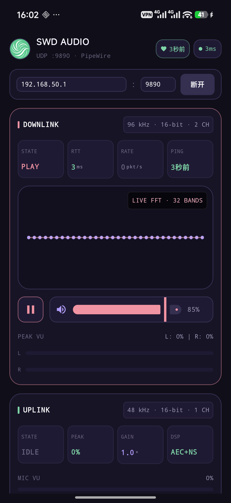
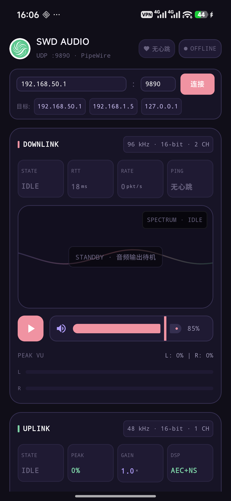
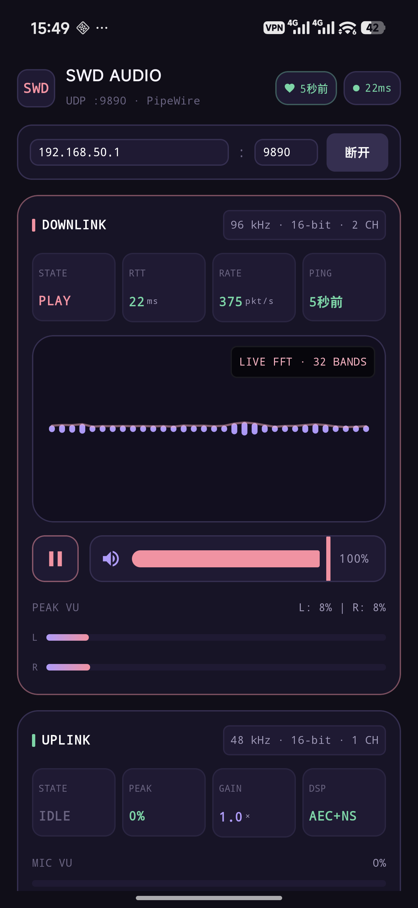

<p align="center">
  
</p>

<h1 align="center">Swdw (SWD)</h1>

<p align="center">
  <strong>Ultra-low Latency PipeWire Audio Stream · Mobile Virtual Mic · Pink Night</strong><br/>
  High-fidelity, bidirectional UDP audio streaming system built with native Rust daemon and Compose Multiplatform.
</p>

<p align="center">
  <strong>English</strong> · <a href="README-CN.md">简体中文</a>
</p>

<p align="center">
  Linux PipeWire · Native Rust Daemon · Desktop JVM · Android Persistent Foreground Service · 96kHz 2CH Stereo · Data-First Minimalism
</p>

---

## What this is

**Swdw** is a local-first, ultra-low latency direct audio streaming system bridging Linux desktops and mobile/cross-platform endpoints. It addresses two primary challenges:
1. **Real-time Playback Monitoring (Downlink)**: Streams the entire Linux host system audio mix in master-grade fidelity (96,000 Hz, 16-bit, stereo) directly to headphones connected to an Android device or laptop, keeping end-to-end latency within human sensory limits (~10-18ms).
2. **Reverse Virtual Microphone (Uplink)**: Feeds mobile microphone audio back to the Linux host with negligible latency, registering a virtual `Audio/Source` input node (`SWD-Virtual-Mic`) in PipeWire for seamless use in Discord, Zoom, OBS, or DAW applications.

### The Problem Swdw Solves

In the Linux desktop ecosystem, routing audio between a workstation and a smartphone has traditionally suffered from frustrating trade-offs:
- **TCP-based Streamers (HTTP / RTSP / PulseAudio TCP tunnels)**: Because TCP mandates sequential in-order delivery, even minor Wi-Fi jitter triggers congestion control and retransmissions. This causes sudden bursts of buffer bloat, audio crackles, or playback acceleration, escalating latency from dozens of milliseconds into hundreds or thousands.
- **Proprietary Tools (AudioRelay, SNDCP)**: Often closed-source, platform-restricted, and lack native integration with Linux's modern audio server, **PipeWire**.
- **Browser/PWA Solutions**: Rely on silent audio loops to simulate background playback. Mobile operating systems invariably kill or freeze the browser tab within minutes of screen timeout.

Swdw takes an uncompromised, **zero-buffer-bloat** approach:
- **Direct PipeWire Native Capture**: The Rust backend binds directly to PipeWire via `cpal`, locking the quantum configuration to `node.latency=256/96000`, resulting in a hardware capture cycle of merely **2.67ms**.
- **Connectionless Direct UDP Datagrams**: MTU-safe packet slicing with sequence numbers for out-of-order detection. In the event of network packet loss, Swdw accepts microscopic skips rather than delaying subsequent audio, guaranteeing permanent real-time synchronization.
- **Decoupled Subscription & Heartbeat**: Audio streaming is strictly decoupled from connection vitality. The client pings the server every 8s (4s timeout threshold for offline detection), while high-throughput audio broadcast is active only when playback is engaged.
- **Persistent Android Foreground Service**: Built upon Android's native foreground service (`mediaPlayback|microphone`) with `WakeLock` and `MediaSessionCompat`, allowing uninterrupted audio even with the screen locked.

<p align="center">
  
</p>

---

## Features

- **Master-grade 96,000 Hz / 16-bit 2-Channel Downlink**: Captures the default PipeWire output mix in studio-grade fidelity.
- **Bidirectional Virtual Microphone Node**: Registers a 48kHz `Audio/Source` node in PipeWire with on-device Acoustic Echo Cancellation (AEC) and Noise Suppression (NS).
- **Data-First Minimalism (KataHana Aesthetics)**:
  - Free of marketing fluff. Focused on clean engineering metrics: `STATE`, `RTT` (round-trip time), `RATE` (pkt/s), `PING` (elapsed since last heartbeat), `PEAK`, `GAIN` (0.1x to 3.0x), and `DSP`.
  - Independent dual-channel Peak VU meters with real-time dynamic range display.
  - 32-band real-time FFT frequency spectrum canvas and smooth standby envelope waveforms.
  - Powered by AndroidX Material Extended Icons with strict single-line text formatting.
- **Interactive Lock-screen Notification (MediaSession)**:
  - Native lock-screen card featuring server host emblem (Arch Linux) and playback controls.
  - Instant actions: Play/Pause, Microphone toggle, and Disconnect.
- **Single-command systemd User Service**: Starts automatically on Linux user login, consuming < 1% CPU.
- **Compose Multiplatform Architecture**: Unified core audio decoding and UI components across JVM desktop and Android.

---

## Screenshots

| Standby Dashboard | Active Audio Streaming | Lock-screen Notification Card |
|:---:|:---:|:---:|
|  |  |  |

---

## Direct UDP Protocol Specification

All UDP packets begin with a 4-byte magic signature `SWD\x01` (`0x53, 0x57, 0x44, 0x01`):

| Opcode | Packet Type | Direction | Payload Structure |
|:---:|:---:|:---:|:---|
| `0x01` | Downlink Audio Data | Server → Client | `[4B Magic][1B 0x01][4B Seq][4B SampleRate][1B Channels][1B Bits][2B PayloadLen][PCM 16-bit LE Data]` |
| `0x02` | Uplink Microphone Data | Client → Server | `[4B Magic][1B 0x02][4B Seq][4B SampleRate][1B Channels][1B Flags][2B PayloadLen][PCM 16-bit LE Data]` |
| `0x03` | Audio Subscription / Keepalive | Client → Server | `[4B Magic][1B 0x03][4B ClientId]` (Subscribe to audio broadcast) |
| `0x04` | Unsubscribe / Disconnect | Client → Server | `[4B Magic][1B 0x04]` (Stops audio transmission) |
| `0x06` | PING Heartbeat Probe | Client → Server | `[4B Magic][1B 0x06][8B ClientTimestamp]` (8s interval probe) |
| `0x86` | ECHO Heartbeat Reply | Server → Client | `[4B Magic][1B 0x86][8B EchoTimestamp][4B SampleRate][1B Channels]` |
| `0x05` | LAN Service Discovery | Client → Broadcast | `[4B Magic][1B 0x05]` |
| `0x85` | Discovery Response | Server → Client | `[4B Magic][1B 0x85][JSON Telemetry Payload]` |

### Latency Breakdown

| Stage | Typical Latency | Notes |
|:---|:---:|:---|
| PipeWire Quantum Capture | ~2.67 ms | Quantum `256/96000` hardware buffer cycle |
| Daemon UDP Packing | < 0.2 ms | Lock-free ring buffer and zero-copy slicing |
| Local 5GHz Wi-Fi Transfer | ~2.0 - 5.0 ms | Direct UDP packet transmission without TCP queue |
| Client AudioTrack Jitter Buffer | ~8.0 - 12.0 ms | Optimized low-latency audio track mode |
| **Total End-to-End Latency** | **~13 - 19 ms** | Indistinguishable from direct wired connection |

---

## Getting Started

### 1. Run the Rust Daemon (Linux Host)

Prerequisites: `pipewire`, `pipewire-pulse`, `clang`, `rustc` / `cargo`.

```bash
# 1. Grant execution rights and install as systemd user service
chmod +x install_service.sh backend/start.sh
./install_service.sh

# Verify daemon status
systemctl --user status swdwd.service
```

For manual debugging in foreground:
```bash
cd backend
cargo run --release
```
The daemon will listen on `0.0.0.0:9890` for UDP traffic and HTTP `/api/status` telemetry.

### 2. Desktop Client (JVM)

```bash
./gradlew :desktopApp:run
```

### 3. Android Client Installation

```bash
# Check connected device over USB or Wireless ADB
adb devices

# Build Release APK and install directly
./gradlew :androidApp:installRelease

# Launch the app
adb shell am start -n com.acite.swdw/.MainActivity
```

Or assemble standalone APK:
```bash
./gradlew :androidApp:assembleRelease
# Output: androidApp/build/outputs/apk/release/androidApp-release.apk
```

---

## Repository Structure

```
Swdw/
├── backend/                  # Native Rust recording & broadcast daemon
│   ├── src/
│   │   └── main.rs           # PipeWire capture, virtual mic, lock-free ring buffer, UDP engine
│   ├── Cargo.toml            # cpal, tiny_http, sysinfo, socket2
│   └── start.sh              # Direct runner script
├── shared/                   # Compose Multiplatform core module
│   └── src/
│       ├── commonMain/       # Shared engine, models, and UI
│       │   ├── kotlin/com/acite/swdw/
│       │   │   ├── client/   # SwdClientEngine, PPS metrics, heartbeat loop
│       │   │   ├── model/    # ConnectionState, AudioPacket
│       │   │   ├── theme/    # KataHana Night theme & typography
│       │   │   └── ui/       # SwdMainScreen, FFT spectrum, VU canvas, metric cards
│       │   └── composeResources/ # Official logo and vector icons
│       ├── androidMain/      # Android low-latency AudioTrack & AudioRecord
│       └── jvmMain/          # Desktop JVM Java Sound implementations
├── androidApp/               # Native Android application and foreground service
│   └── src/main/
│       ├── kotlin/com/acite/swdw/
│       │   ├── MainActivity.kt
│       │   └── service/AudioStreamService.kt  # MediaSession, Foreground Service, WakeLock
│       └── res/              # Android Adaptive icons and notification resources
├── desktopApp/               # JVM desktop application runner
├── install_service.sh        # systemd user service installation script
├── screenshots/              # Documentation screenshots
└── README.md
```

---

## Design Philosophy

Swdw embraces the design system inspired by [KataHana](https://github.com/rootacite/KataHana):
- **KataHana Night Palette**: Deep, restrained background (`#100E19`) with translucent panel layers (`#181524`, `#201D30`) and delicate border strokes (`HanaStroke`), minimizing visual fatigue during prolonged listening sessions.
- **Sakura Pink Accent**: Essential interactive actions and dynamic pulses utilize soft pink accents (`#FF8DA1`), providing warm contrast against cold technical metrics.
- **Data-First Minimalism**: Elimination of verbose text and marketing blurbs. Technical abbreviations and numeric indicators present exact system states at a glance.

---

## License

This project is licensed under the [GNU General Public License v3.0 (GPL-3.0)](LICENSE).
